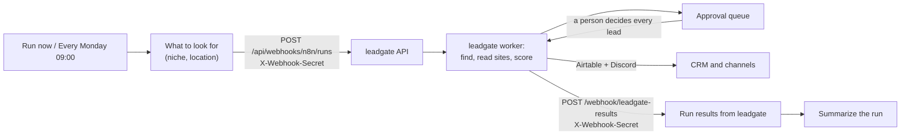

# Switchyard

Switchyard is my self-hosted n8n, and the automation layer for [leadgate](https://github.com/maniesh-lab/leadgate). leadgate finds local businesses, scores them with agents, and lets nothing reach the CRM until a person approves it. Switchyard starts those runs, on demand or every Monday, and gets the results back when a person has decided every lead.

n8n only starts runs and receives results. leadgate writes approved leads to Airtable and posts them to Discord itself, so nothing is written twice.

## How it works



The workflow is [workflows/leadgate.json](workflows/leadgate.json). It has six nodes:

- **Run now** starts a run by hand. **Every Monday 09:00** does it on a schedule; it's off until you turn it on.
- **What to look for** sets the niche (`dentist`), the location (`Austin, TX`) and where leadgate sends the results.
- **Start a leadgate run** posts that to leadgate. leadgate uses the newest open campaign with the same niche and location, or makes one, and answers with the run's id. The run then waits in leadgate's approval queue.
- **Run results from leadgate** is a webhook. When a person has decided every lead, leadgate posts the run's summary here.
- **Summarize the run** turns the summary into one line: how many leads, how many approved, escalated and rejected, and which ones went to the CRM.

Both directions use the same shared secret in the `X-Webhook-Secret` header.

## Quick start (Docker)

You need Docker with the compose plugin, and leadgate running on the same machine.

**1. Start leadgate.** Follow its [quick start](https://github.com/maniesh-lab/leadgate#quick-start-docker), and set `N8N_WEBHOOK_SECRET` in its `.env` (make one with `openssl rand -hex 32`). Its `docker compose up` creates the `leadnet` network that both projects share. To start Switchyard without leadgate, create the network once: `docker network create leadnet`.

**2. Start n8n.**

```bash
git clone https://github.com/maniesh-lab/Switchyard
```

```bash
cd Switchyard
```

```bash
docker compose up -d
```

n8n is at http://localhost:5678. Create the owner account on the first visit.

**3. Add the credential.** In n8n, create a **Header Auth** credential named `leadgate webhook secret`: Name `X-Webhook-Secret`, Value the same `N8N_WEBHOOK_SECRET` as in leadgate's `.env`.

**4. Import the workflow.** Workflows → Import from File → `workflows/leadgate.json`. If n8n asks, pick the credential on **Start a leadgate run** and **Run results from leadgate**.

**5. Publish it.** The results webhook only listens while the workflow is published.

**6. Run it.** Open the workflow and press **Run now**. Decide the leads in leadgate's dashboard (http://localhost:8080, **Queue**). After the last decision, a new execution shows up in n8n with the summary.

## What n8n sends and gets back

n8n sends:

```json
{
  "niche": "dentist",
  "location": "Austin, TX",
  "callback_url": "http://n8n:5678/webhook/leadgate-results"
}
```

Instead of `niche` and `location`, it can send `campaign_id` to run a campaign you made in leadgate. A new campaign made this way uses OpenStreetMap, the `general-b2b` rubric, and up to 50 results. leadgate answers `202` with `run_id`, `campaign_id` and `status`.

leadgate posts back `run_id`, `campaign_id`, `status`, the start and end times, the run's stats, and one line per lead: name, status, score, route and CRM record id. The route is `notify` (approved, in the CRM), `escalate` (approved, needs a second look) or `skip` (rejected). There are no phone numbers or emails in it; approved leads are in the CRM.

## Using CSV leads

Send them to leadgate, not to Airtable. An admin can upload a CSV in leadgate's dashboard. Or the webhook can carry up to 500 leads in a `leads` field, and the run uses those instead of searching. That way every lead still goes through the approval queue.

## Project structure

```
workflows/leadgate.json   the n8n workflow (same file as leadgate's n8n/leadgate.json)
docker-compose.yml        n8n, on its own network and on leadnet
LICENSE
README.md
```

## Known limitations

- **leadgate must be up first.** The compose file joins the `leadnet` network, which leadgate creates. Without it, `docker compose up` fails.
- **The results webhook only listens while the workflow is published.** A run that finishes while it isn't gets its summary tried 3 times by leadgate, then dropped. The run itself is still saved in leadgate.
- **A run can take days.** The summary only comes once a person has decided every lead.
- **The same summary can arrive twice** if leadgate's worker dies right after posting it. Each summary carries its `run_id`, so you can tell.
- **The schedule always searches the same thing.** The niche and location are fixed in **What to look for**; edit them there.
- **It doesn't work with the live demo.** leadgate's public demo turns the webhook off.
- **The n8n image isn't pinned.** `docker compose pull` gets the newest n8n.

## Security

- n8n and leadgate share one secret (`N8N_WEBHOOK_SECRET`). leadgate refuses runs without it, and n8n refuses results without it.
- The secret lives in n8n's credential store and leadgate's `.env`, never in this repo.
- n8n's port only listens on `localhost:5678`. Put n8n behind a proxy with HTTPS before you open it to the internet.

## License

MIT. See [LICENSE](LICENSE).
